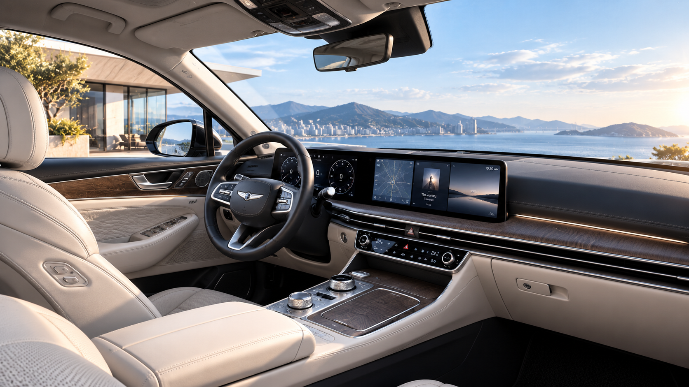

<div align="center">

<p><strong>AUTOMOTIVE · DIGITAL EXPERIENCE · WEB PUBLISHING</strong></p>

# GENESIS<br>Fullscreen Brand Experience

이미지로 시선을 이끌고, 인터랙션으로 제품 탐색을 연결하다.

**브랜드 쇼케이스 & 제품 상세 랜딩페이지 포트폴리오**

[프로젝트 소개](#01-overview) · [디자인 방향](#02-design-direction) · [비주얼 갤러리](#04-visual-gallery) · [기술 구현](#05-engineering) · [실행 및 배포](#07-getting-started)

</div>


> **프로젝트 성격** — GENESIS를 소재로 제작한 교육·포트폴리오용 웹 퍼블리싱 데모입니다. 공식 사이트 또는 실제 고객사 납품 프로젝트로 제시하지 않습니다. 아래 이미지는 프로젝트 원본 에셋이며, 실행 화면 캡처가 아닙니다.

---

## 01. Overview

### 브랜드의 첫인상에서 제품 탐색까지

자동차의 외관과 실내 이미지를 화면 전면에 배치하고, 관심 있는 콘텐츠를 상세 정보로 연결하는 정적 웹사이트입니다. 메인에서는 시각적 몰입에 집중하고, 상세페이지에서는 소개·제원·브랜드 메시지·가격을 순차적으로 제공합니다.

이 프로젝트는 **풀스크린 비주얼, 직관적인 탐색, 재사용 가능한 상세페이지**를 하나의 흐름으로 구현하는 데 초점을 맞췄습니다.

| Project information | Details |
| :--- | :--- |
| 프로젝트 유형 | 자동차 브랜드 쇼케이스 / 랜딩페이지 |
| 제작자 | Moon Seon Jong |
| 제작 목적 | 온라인 광고·홈페이지 디자인 학습 및 포트폴리오 |
| 구현 범위 | 메인 캐러셀, 콘텐츠별 상세 화면, 반응형 스타일, 인터랙션 |
| 화면 구성 | 메인 1종 + 공용 상세페이지 1종 |
| 콘텐츠 구성 | 8개 비주얼과 각 콘텐츠의 상세 데이터 |
| 기술 구성 | HTML5 · CSS3 · Vanilla JavaScript |
| 실행 환경 | 별도 빌드 없이 브라우저에서 실행하는 정적 사이트 |

### Experience goals

| 목표 | 화면에서의 구현 |
| :--- | :--- |
| 브랜드 이미지에 집중 | 전체 화면 이미지와 최소한의 탐색 요소 배치 |
| 제품을 자연스럽게 탐색 | 자동재생과 수동 탐색을 함께 제공 |
| 관심을 상세 정보로 연결 | 이미지 클릭·탭으로 해당 콘텐츠의 상세페이지 열기 |
| 콘텐츠 운영의 반복 작업 축소 | 공용 HTML과 데이터 배열을 이용한 상세 화면 구성 |

위 목표는 설계 의도입니다. 방문자 전환율이나 사업 성과를 측정한 결과는 포함하지 않습니다.

---

## 02. Design Direction

### Visual-first, content-led

큰 이미지로 첫인상을 만들고, 필요한 정보가 스크롤 순서에 따라 이어지도록 구성했습니다. 어두운 배경과 밝은 타이포그래피를 기본으로 사용해 사진과 텍스트의 대비를 확보합니다.

| 디자인 요소 | 적용 방식 |
| :--- | :--- |
| Color | 검정·짙은 회색 배경과 흰색 텍스트 중심의 절제된 팔레트 |
| Typography | 큰 모델명, 짧은 설명, 작은 영문 레이블로 정보 위계 구분 |
| Layout | 전체 화면 히어로와 넓은 섹션 여백 |
| Image | `cover` 방식으로 화면을 채우고 그라데이션 오버레이 적용 |
| Navigation | 원형 이전·다음 버튼, 슬라이드 카운터, 하단 진행 막대 |
| Motion | 수평 슬라이드, 타이틀 등장, 스크롤 리빌, 패럴럭스 |
| Responsive | `clamp()`, 유동 너비, 미디어 쿼리로 크기와 간격 조정 |

이미지는 화면을 채우는 방식이므로 기기 비율에 따라 가장자리가 일부 잘릴 수 있습니다.

---

## 03. Key Experience

### 01 — Fullscreen carousel

8개의 비주얼을 전체 화면으로 탐색합니다. 4초 대기 후 0.5초 동안 다음 슬라이드로 전환하며, 마지막 콘텐츠 이후에는 첫 콘텐츠로 이어집니다. 현재 번호와 진행 막대로 탐색 위치를 안내합니다.

### 02 — Multiple ways to explore

이전·다음 버튼, 키보드 방향키, 마우스 드래그, 터치 스와이프를 제공합니다. 클릭·탭과 드래그를 이동 거리로 구분하며, 클릭으로 판정되면 상세페이지를 새 탭으로 엽니다. 포커스된 슬라이드에서는 `Enter` 또는 `Space`로 상세 화면을 열 수 있습니다.

### 03 — Product storytelling

상세 화면은 제품 이미지에서 제원, 브랜드 메시지, 예시 가격으로 이어집니다. 섹션 등장 애니메이션과 패럴럭스 효과를 적용하고, 맨 위로 이동 및 메인 화면으로 돌아가기 기능을 제공합니다.

### 04 — One template, eight stories

`landing.html?slide=1`부터 `landing.html?slide=8`까지 하나의 상세 템플릿에서 다른 콘텐츠를 표시합니다. 선택한 번호에 따라 이미지, 모델명, 설명, 제원, 가격을 바꿉니다.

```text
BRAND DISCOVERY              PRODUCT EXPLORATION

메인 캐러셀                  상세 랜딩페이지
┌──────────────────┐        ┌────────────────────┐
│ 전체 화면 이미지  │        │ Hero · 이미지/모델명 │
│ 제목 / 소개 문구  │  클릭  │ Specifications     │
│ 이전·다음 탐색    │ ─────→ │ Brand visual       │
│ 카운터 / 진행 바 │ 새 탭  │ Price · 예시 가격   │
└──────────────────┘        │ 메인 복귀 / TOP     │
                            └────────────────────┘
```

---

## 04. Visual Gallery

프로젝트에 사용된 원본 이미지 8종입니다. 표기는 코드에 설정된 콘텐츠명을 기준으로 하며, 각 이미지를 클릭하면 원본 파일을 볼 수 있습니다.

| 01 / Flagship Luxury | 02 / Luxury SUV |
| :---: | :---: |
| [](images/slide01.png) | [](images/slide02.png) |
| **GENESIS G90** | **GENESIS GV80** |

| 03 / Signature Presence | 04 / Interior Experience |
| :---: | :---: |
| [](images/slide03.png) | [](images/slide04.png) |
| **GENESIS GV80** | **GENESIS INTERIOR** |

| 05 / Road Performance | 06 / Urban Luxury |
| :---: | :---: |
| [](images/slide05.png) | [](images/slide06.jpg) |
| **GENESIS G80** | **GENESIS GV70** |

| 07 / Dynamic Design | 08 / Grand Touring |
| :---: | :---: |
| [](images/slide07.jpg) | [](images/slide08.jpg) |
| **GENESIS GV70** | **GENESIS G80** |

---

## 05. Engineering

### 기술 선택과 역할

| Technology | Responsibility |
| :--- | :--- |
| HTML5 | 메인·상세 화면의 시맨틱 구조 및 탐색 요소 |
| CSS3 | 반응형 배치, 이미지 오버레이, 전환·등장 애니메이션 |
| Vanilla JavaScript | 슬라이드 상태와 타이머 관리, 상세 데이터 렌더링 |
| Pointer Events | 마우스와 터치 입력 처리 |
| URLSearchParams | 선택한 슬라이드 번호 읽기 |
| IntersectionObserver | 화면에 진입한 상세 섹션의 등장 효과 |
| requestAnimationFrame | 스크롤에 따른 패럴럭스 갱신 |

### 구현 포인트

**끊김 없는 순환 구조**  
첫 번째와 마지막 슬라이드의 복제본을 양 끝에 배치합니다. 복제본으로 이동한 뒤 `transitionend` 시점에 실제 슬라이드 위치로 전환 효과 없이 옮겨 순환 구조를 만듭니다.

**입력 의도 구분**  
클릭 판정 기준은 10px, 슬라이드 전환 기준은 55px입니다. 짧은 드래그는 원래 위치로 복귀하고, 전환 기준을 넘으면 이전·다음 콘텐츠를 표시합니다.

**화면과 콘텐츠 분리**  
메인 콘텐츠는 `slides`, 상세 콘텐츠는 `DATA` 배열에서 관리합니다. 두 배열의 순서와 이미지 파일명을 맞추면 공용 상세페이지에서 해당 콘텐츠를 표시할 수 있습니다.

**전환과 대기 시간 분리**  
슬라이드 전환 완료 후 다음 자동재생 타이머를 시작합니다. 진행 막대의 CSS 애니메이션 시간은 JavaScript의 자동재생 대기 시간과 함께 관리합니다.

---

## 06. Project Structure

```text
.
├── index.html              # 메인 캐러셀
├── landing.html            # 공용 상세페이지
├── css/
│   ├── reset.css           # 기본 스타일 초기화
│   ├── style.css           # 메인 스타일 및 진행 막대
│   └── landing.css         # 상세 스타일 및 스크롤 효과
├── js/
│   ├── script.js           # 슬라이드 데이터 / 상태 / 입력 처리
│   └── landing.js          # 상세 데이터 / 렌더링 / 스크롤 처리
├── images/
│   ├── slide01.png ~ slide05.png
│   └── slide06.jpg ~ slide08.jpg
├── 프롬프트.txt             # 제작 참고 자료
├── README.txt              # 기존 안내 문서
└── README.md               # 프로젝트 포트폴리오
```

### Content maintenance

| 변경 사항 | 수정 위치 |
| :--- | :--- |
| 메인 이미지·제목·설명 | `js/script.js` → `slides` |
| 상세 이미지·문구·제원·가격 | `js/landing.js` → `DATA` |
| 자동재생 시간 | `AUTO_DELAY`와 `css/style.css`의 진행 막대 시간 |
| 메인 화면 스타일 | `css/style.css` |
| 상세 화면 스타일 | `css/landing.css` |
| 슬라이드 추가·삭제 | 두 데이터 배열과 `index.html`의 전체 개수 `08` |

이미지 파일명을 바꾸면 JavaScript 데이터와 README 갤러리의 상대 경로도 함께 수정합니다.

---

## 07. Getting Started

### Local preview

저장소를 다운로드하거나 복제한 뒤 `index.html`을 브라우저에서 엽니다. 별도의 패키지 설치, API 키, 빌드 과정은 필요하지 않습니다. 개발 시에는 로컬 정적 서버에서도 실행할 수 있습니다.

### GitHub Pages

1. `index.html`, `landing.html`, `README.md`와 `css`, `js`, `images` 폴더를 저장소 최상위에 업로드합니다.
2. 저장소의 **Settings → Pages**로 이동합니다.
3. **Source → Deploy from a branch**를 선택합니다.
4. 소스가 있는 브랜치(예: `main`)와 `/(root)`를 선택하고 저장합니다.
5. 배포 완료 후 Pages 설정 화면에 표시되는 주소에서 사이트를 확인합니다.

ZIP 패키지를 사용하는 경우 압축을 먼저 풀고 내용물을 업로드합니다. README 이미지가 표시되려면 `images` 폴더도 함께 있어야 합니다.

배포 설정 참고: [GitHub Pages 공식 문서](https://docs.github.com/en/pages/getting-started-with-github-pages/configuring-a-publishing-source-for-your-github-pages-site)

---

## 08. Project Notes

### 현재 구현 범위

정적 프런트엔드 데모이며 상담 접수, 회원 기능, 결제, CMS 및 서버 연동은 포함하지 않습니다. 실제 배포 주소와 운영 성과 수치는 이 문서에 기재하지 않았습니다.

현재 코드는 이미지 클릭 시 자동재생 타이머를 멈춘 뒤 상세페이지를 엽니다. 메인 탭으로 돌아왔을 때 자동으로 재생을 재개하는 기능은 없으며, 이전·다음 버튼을 눌러 전환하면 자동재생이 다시 진행됩니다.

### 추가 개선 과제

다음 항목은 구현 완료 기능이 아닌 후속 개선 항목입니다.

- 자동재생 일시정지·재개 버튼 및 탭 복귀 시 상태 처리
- 이미지 용량 최적화와 기기별 이미지 제공
- 모션 감소 설정 대응과 키보드 포커스 흐름 점검
- 실제 기기·브라우저별 동작 및 성능 검증

### Credits

**Moon Seon Jong · Web Publishing Portfolio**

프로젝트의 차량 제원과 가격은 교육용 예시 데이터입니다. 브랜드명과 이미지가 포함되어 있으며, 본 문서는 해당 자산에 대한 별도 이용 허락이나 라이선스를 부여하지 않습니다.

---

<div align="center">

**GENESIS — Fullscreen Brand Experience**  
HTML · CSS · JavaScript

</div>
